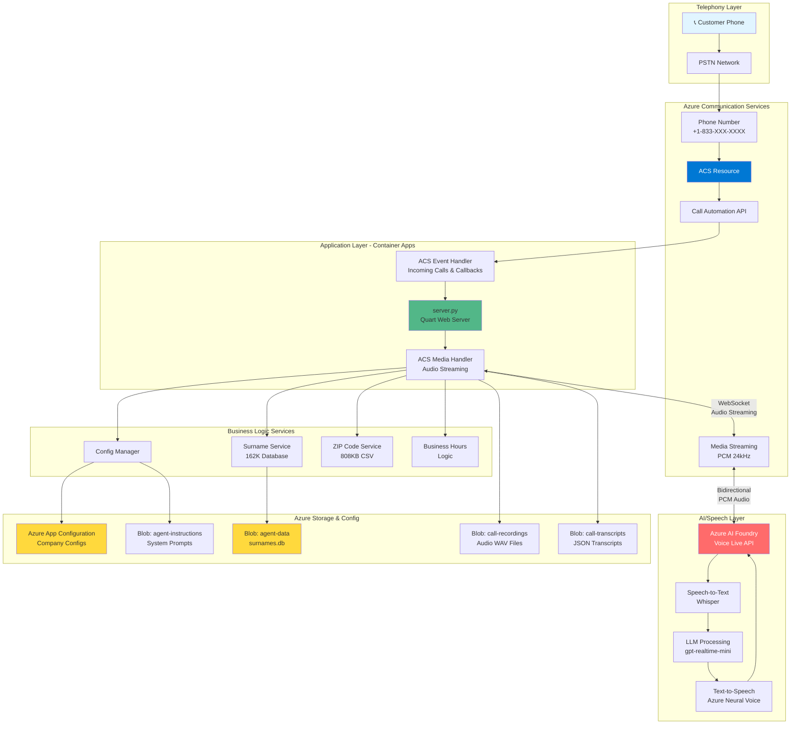
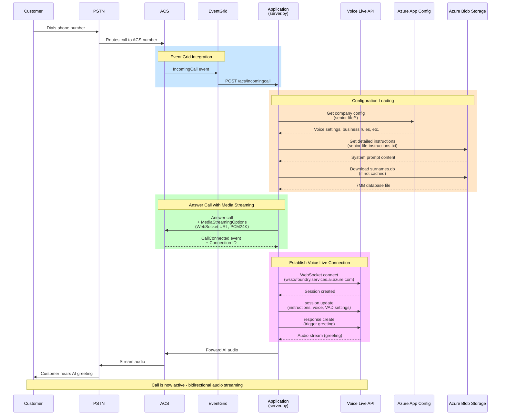
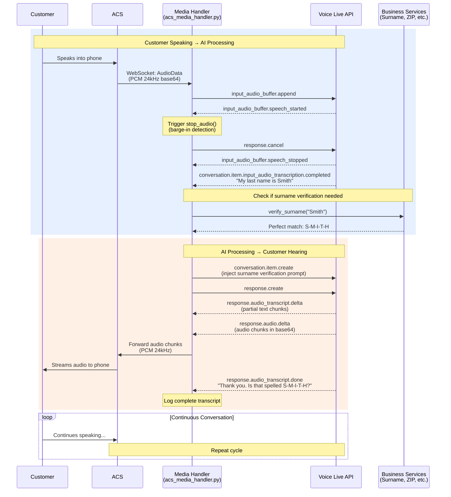
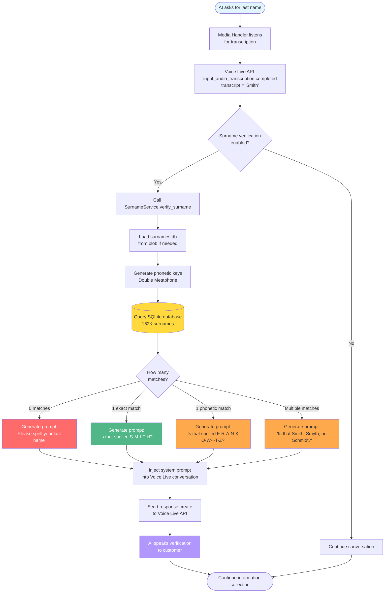
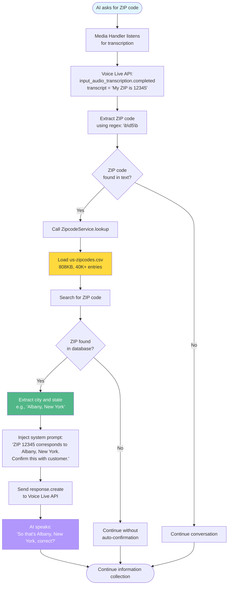
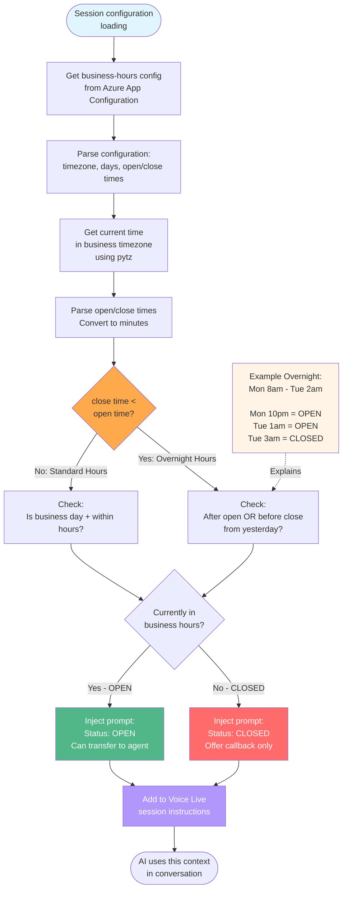
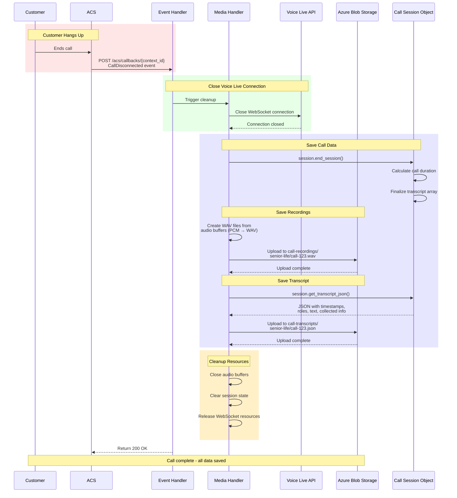
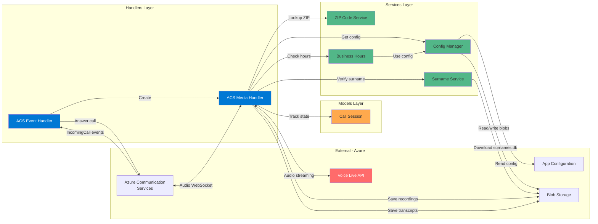
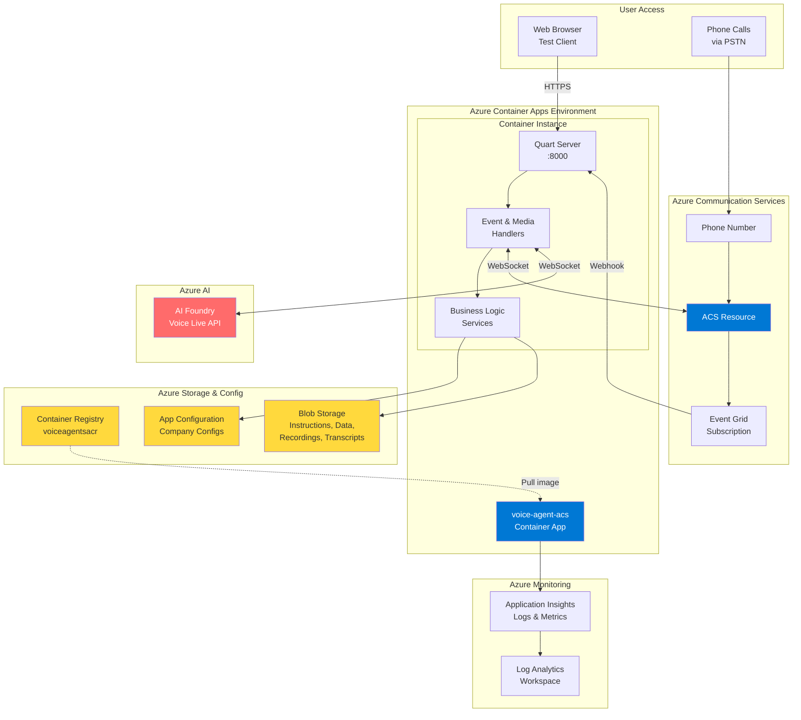

# ACS + Voice Live API - Architecture Diagrams

This document contains visual Mermaid diagrams illustrating the system architecture and data flows for the ACS + Voice Live API migration.

---

## 1. Overall System Architecture



---

## 2. Call Initiation Sequence



---

## 3. Active Call - Audio Streaming Flow



---

## 4. Surname Verification Integration



---

## 5. ZIP Code Lookup Flow



---

## 6. Business Hours Logic Flow



---

## 7. Call Termination & Cleanup



---

## 8. Component Interaction Map



---

## 9. Deployment Architecture



---

## Diagram Rendering

These diagrams use **Mermaid** syntax and will render automatically in:

- ✅ GitHub (in markdown files)
- ✅ GitLab
- ✅ VS Code (with Mermaid extension)
- ✅ Many markdown viewers
- ✅ Documentation sites (MkDocs, Docusaurus, etc.)

### Viewing Locally

If your markdown viewer doesn't support Mermaid:

1. **Install VS Code Mermaid Extension:**
   ```
   code --install-extension bierner.markdown-mermaid
   ```

2. **Use Online Mermaid Editor:**
   - https://mermaid.live/
   - Copy/paste diagram code to preview

3. **GitHub Preview:**
   - Push to GitHub and view there (native support)

---

## Diagram Index

| # | Diagram | Purpose |
|---|---------|---------|
| 1 | Overall System Architecture | High-level component view |
| 2 | Call Initiation Sequence | Step-by-step call setup |
| 3 | Active Call Audio Flow | Bidirectional streaming |
| 4 | Surname Verification | Phonetic matching logic |
| 5 | ZIP Code Lookup | Auto city/state confirmation |
| 6 | Business Hours Logic | Overnight hours support |
| 7 | Call Termination | Cleanup and data saving |
| 8 | Component Interaction | Service dependencies |
| 9 | Deployment Architecture | Azure resources layout |

---

**Note:** These diagrams complement the text descriptions in `ACS_MIGRATION_ARCHITECTURE.md`.
