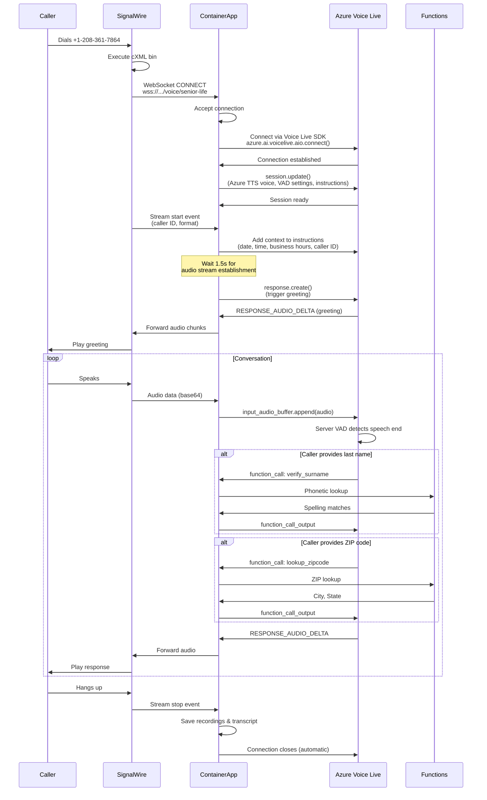
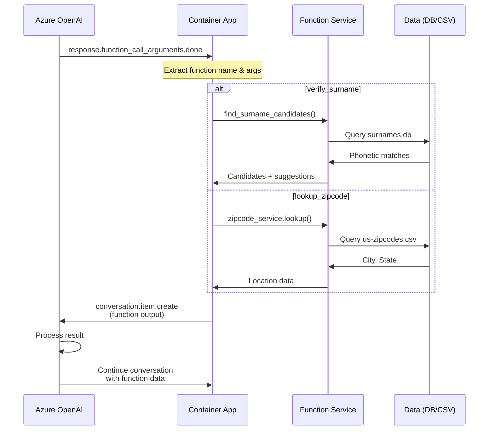

# SignalWire + Azure Voice Live API - Architecture Documentation

**Last Updated:** October 30, 2025

**Current Stack:**
- **Telephony:** SignalWire (+1 208-361-7864)
- **AI Engine:** Azure Voice Live API with Azure TTS (gpt-realtime-mini)
- **Voice:** en-US-FableTurboMultilingualNeural (Azure TTS)
- **Hosting:** Azure Container Apps
- **Audio Format:** PCM 16-bit, 24kHz, Mono
- **Branch:** `claude/session-011CUYMhLCAz3vtenVZXfP8v` (Latest: Oct 29, 2025)

---

## 1. Overall System Architecture

```mermaid
graph TB
    subgraph "Telephony Layer"
        Phone[📞 Customer Phone]
        PSTN[PSTN Network]
        SWNum[SignalWire Number<br/>+1-208-361-7864]
    end

    subgraph "SignalWire Platform"
        SWXML[cXML Bin<br/>Stream Configuration]
        SWStream[Media Stream<br/>WebSocket<br/>L16@24kHz]
    end

    subgraph "Application Layer - Azure Container Apps"
        App[app.py<br/>FastAPI Server]
        WSHandler[WebSocket Handler<br/>/voice/senior-life]
        AudioForward[Audio Forwarder<br/>SignalWire ↔ Azure]
    end

    subgraph "AI/Speech Layer"
        AzureAI[Azure Voice Live API]
        Endpoint[Azure AI Services<br/>.services.ai.azure.com]
        Model[gpt-realtime-mini]
        Voice[Azure TTS Voice<br/>en-US-FableTurboMultilingualNeural]
        VAD[Server-side VAD<br/>Configurable (0.3, 800ms, 200ms)]
    end

    subgraph "Function Calling Services"
        SurnameFn[verify_surname()<br/>Phonetic Matching]
        ZipcodeFn[lookup_zipcode()<br/>City/State Lookup]
        SurnameDB[(surnames.db<br/>162K Records)]
        ZipCSV[(us-zipcodes.csv<br/>808KB)]
    end

    subgraph "Azure Storage & Config"
        AppConfig[Azure App Configuration<br/>Company Settings]
        BlobInstr[Blob: agent-instructions<br/>Cedar's Script]
        BlobRec[Blob: call-recordings<br/>Audio WAV Files]
        BlobTrans[Blob: call-transcripts<br/>JSON Transcripts]
    end

    Phone --> PSTN
    PSTN --> SWNum
    SWNum --> SWXML
    SWXML --> SWStream

    SWStream <-->|WSS<br/>Bidirectional| WSHandler
    WSHandler --> App
    App --> AudioForward

    AudioForward <-->|Voice Live SDK<br/>PCM Audio| AzureAI
    AzureAI --> Endpoint
    Endpoint --> Model
    Model --> Voice
    Voice --> VAD

    Model -->|Function Calls| SurnameFn
    Model -->|Function Calls| ZipcodeFn
    SurnameFn --> SurnameDB
    ZipcodeFn --> ZipCSV

    App --> AppConfig
    AppConfig --> BlobInstr
    App --> BlobRec
    App --> BlobTrans

    style Phone fill:#e1f5ff
    style SWNum fill:#ff6b6b,color:#fff
    style App fill:#52b788
    style AzureAI fill:#0078d4,color:#fff
    style AppConfig fill:#ffd93d
    style SurnameFn fill:#95e1d3
    style ZipcodeFn fill:#95e1d3
```

---

## 2. Call Flow Sequence



---

## 3. Audio Format & Streaming

### SignalWire Configuration (cXML)
```xml
<?xml version="1.0" encoding="UTF-8"?>
<Response>
  <Connect>
    <Stream url="wss://voice-agents-bridge.victoriouswave-f95f67ff.eastus2.azurecontainerapps.io/voice/senior-life"
            codec="L16@24000h" />
  </Connect>
</Response>
```

### Audio Pipeline
```
Caller → SignalWire → WebSocket → Container App → Azure OpenAI
         PCM 24kHz    L16@24kHz    PCM16        PCM16
```

**Format Details:**
- **Encoding:** Linear PCM (16-bit signed integers)
- **Sample Rate:** 24,000 Hz
- **Channels:** Mono (1 channel)
- **Bit Depth:** 16 bits
- **Transmission:** Base64-encoded chunks via WebSocket

---

## 4. Function Calling Architecture

### Available Tools

#### 1. `verify_surname(surname: string)`
**Purpose:** Phonetic surname verification for accurate spelling confirmation

**Process:**
1. Caller says their last name
2. Model calls `verify_surname("Smith")`
3. Function queries surnames.db (162K records)
4. Returns phonetic matches with confidence scores
5. Model confirms spelling: "Is that spelled S-M-I-T-H?"

**Database:** SQLite with Double Metaphone phonetic indexing

#### 2. `lookup_zipcode(zipcode: string)`
**Purpose:** City/state confirmation from ZIP code

**Process:**
1. Caller provides ZIP code
2. Model calls `lookup_zipcode("22124")`
3. Function queries us-zipcodes.csv
4. Returns city and state
5. Model confirms: "So you're in Oakton, Virginia"

**Data:** 33K+ US ZIP codes with city/state mappings

### Function Call Flow


---

## 5. Configuration Management

### Environment Variables (Azure Container App)

```bash
# Azure Voice Live API Settings
AZURE_AI_ENDPOINT=https://your-resource.services.ai.azure.com
AZURE_AI_KEY=<secret-reference>
AZURE_AI_MODEL=gpt-realtime-mini

# Storage & Configuration
APP_CONFIG_CONNECTION_STRING=<connection-string>
AZURE_STORAGE_CONNECTION_STRING=<connection-string>
BLOB_CONTAINER_NAME=agent-instructions
RECORDINGS_CONTAINER_NAME=call-recordings
TRANSCRIPTS_CONTAINER_NAME=call-transcripts

# Feature Flags
SAVE_RECORDINGS=true
SAVE_TRANSCRIPTS=true
LOG_LEVEL=INFO
```

### Azure App Configuration Keys

**Company Configuration:**
- `senior-life/basic-info` - Company name, industry
- `senior-life/voice-config` - Voice selection, temperature
- `senior-life/contact-info` - Phone, email
- `senior-life/business-rules` - Transfer hours, callback timeframe
- `senior-life/business-hours` - Days, open/close times, timezone
- `senior-life/audio-settings` - Temperature, max tokens

**Voice Configuration Example:**
```json
{
  "name": "alloy",
  "temperature": 0.4
}
```

**Business Hours Example:**
```json
{
  "timezone": "US/Eastern",
  "days": [0, 1, 2, 3, 4],
  "open-time": "08:30",
  "close-time": "17:00"
}
```

### Blob Storage Structure

```
agent-instructions/
  └── senior-life-instructions.txt    (Cedar's detailed script)

call-recordings/
  └── senior-life/
      ├── <call-sid>-caller.wav
      └── <call-sid>-ai.wav

call-transcripts/
  └── senior-life/
      └── <call-sid>.json

agent-data/
  ├── surnames.db
  └── us-zipcodes.csv
```

---

## 6. Voice Activity Detection (VAD) Settings

### Current Configuration (Configurable via Azure App Config)

VAD settings are now configurable per company via the `{company-id}/audio-settings` section:

```python
# From config.py - Default values
"vad-threshold": 0.3,              # Sensitivity (0.0-1.0)
"vad-prefix-padding-ms": 200,      # Pre-speech buffer
"vad-silence-duration-ms": 800,    # Silence for turn end
"temperature": 0.8,
"max-response-tokens": 4096
```

**Applied in Voice Live SDK:**
```python
turn_detection_config = ServerVad(
    threshold=float(audio_settings.get('vad-threshold', 0.3)),
    prefix_padding_ms=int(audio_settings.get('vad-prefix-padding-ms', 200)),
    silence_duration_ms=int(audio_settings.get('vad-silence-duration-ms', 800))
)
```

### Tuning Guide

| Issue | Adjustment |
|-------|------------|
| Cedar talks over caller | Lower threshold (0.2-0.3) |
| Cedar cuts off too early | Raise threshold (0.4-0.5) |
| Slow interruption response | Reduce prefix_padding_ms (100-200) |
| Fast interruption response | Increase prefix_padding_ms (300-500) |
| Abrupt turn endings | Increase silence_duration_ms (600-1000) |
| Slow turn detection | Reduce silence_duration_ms (300-500) |

---

## 7. Deployment Architecture

### Container App Configuration

**Resource:** `voice-agents-bridge`
**Resource Group:** `voice_agents`
**Region:** East US 2
**Image:** `voiceagentsenvironmentf2c46d.azurecr.io/voice-agent-signalwire:latest`

**Ingress:**
- **External:** Yes
- **Transport:** Auto (supports WebSocket)
- **Target Port:** 8000
- **FQDN:** `voice-agents-bridge.victoriouswave-f95f67ff.eastus2.azurecontainerapps.io`

**Scaling:**
- **Min Replicas:** 1
- **Max Replicas:** 3
- **CPU:** 1.0 core
- **Memory:** 2Gi

**Health Checks:**
- **Liveness:** GET /healthz (every 30s)
- **Startup:** GET /healthz (every 10s)

### Build & Deploy Process

```bash
# 1. Pull latest code
cd ~/voice-agents-platform
git pull origin claude/session-011CUYMhLCAz3vtenVZXfP8v

# 2. Build container image
az acr build \
    --registry voiceagentsenvironmentf2c46d \
    --image voice-agent-signalwire:latest \
    --file Dockerfile \
    .

# 3. Deploy to Container App
az containerapp update \
    --name voice-agents-bridge \
    --resource-group voice_agents \
    --set-env-vars "FORCE_RESTART=$(date +%s)"

# 4. Verify deployment
az containerapp revision list \
    --name voice-agents-bridge \
    --resource-group voice_agents \
    --query "[?properties.active==\`true\`].{Name:name, Created:properties.createdTime}" \
    --output table
```

---

## 8. Key Differences from Previous Architectures

| Aspect | OpenAI Realtime (Old) | Voice Live API (Current) |
|--------|-----------|------------------|
| **SDK** | Direct WebSocket (websockets) | Azure Voice Live SDK (azure-ai-voicelive) |
| **Connection Method** | Manual WebSocket URL construction | SDK `connect()` with typed models |
| **Voice Options** | 6 OpenAI voices (alloy, shimmer, etc.) | 600+ Azure TTS Neural voices |
| **Voice Quality** | Inconsistent prosody | Consistent Azure TTS with SSML support |
| **Current Voice** | N/A (OpenAI voices) | en-US-FableTurboMultilingualNeural |
| **Configuration** | JSON strings via WebSocket | Typed Python models (RequestSession, ServerVad) |
| **Audio Sending** | Manual JSON: `{"type": "input_audio_buffer.append"}` | SDK method: `input_audio_buffer.append(audio)` |
| **Event Handling** | JSON parsing of event types | Typed ServerEventType enums |
| **VAD Configuration** | Hardcoded in session config | ✅ Configurable per company via Azure App Config |
| **Business Hours** | Hardcoded US/Eastern M-F | ✅ Configurable per company (timezone, days, hours, overnight support) |

---

## 9. Testing & Troubleshooting

### Test Call Checklist

1. **Call the number:** +1 (208) 361-7864
2. **Verify greeting:** "Thank you for calling Senior Life Insurance Company. My name is Cedar..."
3. **Test interruption:** Speak while Cedar is talking (should stop quickly)
4. **Test surname verification:** Say your last name → Cedar confirms spelling
5. **Test ZIP lookup:** Provide ZIP code → Cedar confirms city/state
6. **Check recordings:** Verify WAV files saved to blob storage
7. **Check transcripts:** Verify JSON transcript saved

### Common Issues

#### Greeting Cutoff
**Symptom:** First part of greeting is cut off
**Cause:** Insufficient delay after audio stream establishment
**Fix:** Increase `asyncio.sleep()` value (currently 1.5s)

#### Erratic Behavior
**Symptom:** Cedar jumps around script, doesn't follow order
**Cause:** Missing quotation marks in script or high temperature
**Fix:** Add quotes around example phrases, ensure temperature ≤ 0.4

#### Squeaky Voice on Numbers
**Symptom:** Voice sounds unnatural when reading numbers
**Cause:** Temperature too high
**Fix:** Set temperature to 0.4 in voice-config

#### Talking Over Caller
**Symptom:** Cedar doesn't stop when interrupted
**Cause:** VAD threshold too high
**Fix:** Lower threshold to 0.2-0.3

### Monitoring & Logs

```bash
# Stream live logs
az containerapp logs show \
    --name voice-agents-bridge \
    --resource-group voice_agents \
    --follow

# Check specific revision logs
az containerapp logs show \
    --name voice-agents-bridge \
    --resource-group voice_agents \
    --revision voice-agents-bridge--0000XXX
```

**Key log patterns to watch:**
- `✅ SignalWire connection accepted`
- `✅ Azure OpenAI Realtime connection established`
- `▶️ Call started`
- `🔧 Function call: verify_surname` / `lookup_zipcode`
- `✅ Triggered greeting`

---

## 10. Future Enhancements

### Potential Improvements
- [ ] Add transfer capability to live agents
- [ ] Implement call recording playback API
- [ ] Add real-time transcript streaming
- [ ] Multi-company support (beyond senior-life)
- [ ] Analytics dashboard for call metrics
- [ ] A/B testing different voice personalities
- [ ] Integration with CRM systems
- [ ] Voicemail detection and handling

### Security Enhancements
- [ ] Implement rate limiting per caller
- [ ] Add authentication for API endpoints
- [ ] Encrypt call recordings at rest
- [ ] PCI compliance for payment info collection
- [ ] HIPAA compliance for health data (if needed)

---

## 11. Cost Optimization

### Current Usage Estimates

**Azure OpenAI Realtime API:**
- ~$0.06 per minute of audio processing
- 10-minute average call = $0.60
- 1000 calls/month = $600/month

**SignalWire:**
- Inbound: $0.0085/min
- 10-minute call = $0.085
- 1000 calls/month = $85/month

**Azure Container Apps:**
- ~$30-50/month (depending on usage)

**Azure Storage:**
- ~$5-10/month (call recordings)

**Total Estimated:** ~$720-745/month for 1000 calls

### Cost Optimization Tips
1. Set aggressive `max_response_output_tokens` limits
2. Use shorter VAD silence durations (faster turn detection = less audio generation)
3. Implement call recording retention policies (auto-delete after 90 days)
4. Scale down container app during off-hours
5. Consider caching common responses

---

## Support & Maintenance

**Git Repository:** `voice-agents-platform`
**Active Branch:** `claude/session-011CUYMhLCAz3vtenVZXfP8v`
**Last Updated:** October 30, 2025
**Current Version:** 14.0 - Azure Voice Live API

**Key Features:**
- Azure Voice Live SDK integration
- Azure TTS voices with consistent prosody
- Configurable VAD settings per company
- Configurable business hours with overnight support
- Surname verification and ZIP lookup
- Call recordings and transcripts

For questions or issues, check:
1. This documentation
2. Application logs (`az containerapp logs show`)
3. Azure Portal health checks
4. SignalWire dashboard for call metrics
5. Voice Live API documentation: https://learn.microsoft.com/azure/ai-services/speech-service/voice-live
